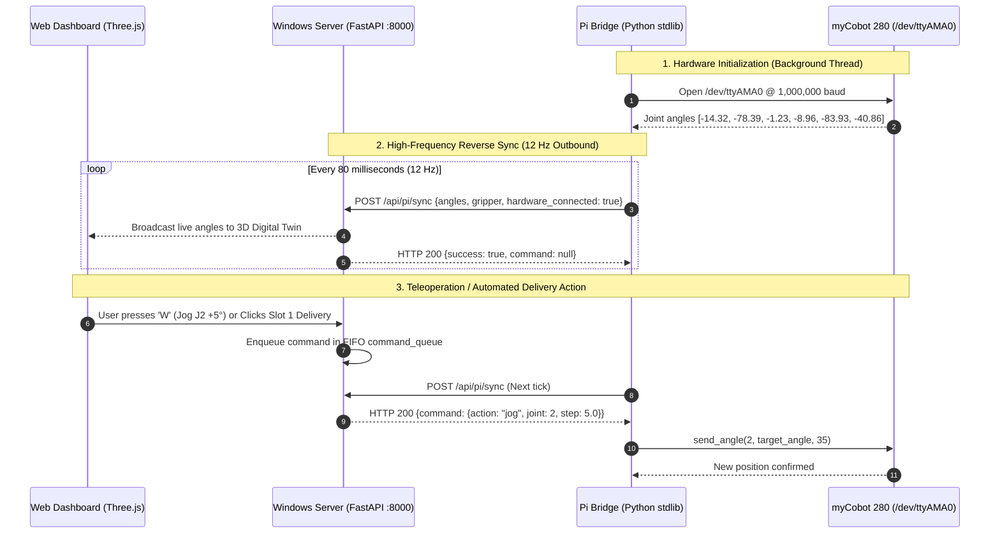

# THE DILUTION: Smart Medicine Delivery System
## Comprehensive Technical Documentation & Architecture Manual
### Course: CAT403 Biomedical Robotics • Platform: Elephant Robotics myCobot 280 Pi

---

## 1. Executive Summary & Clinical Purpose

**TheDilution** is an automated hospital medication compounding and delivery platform developed to replace manual, error-prone pharmaceutical dilutions with a high-precision, 60-second automated preparation cycle.

```
                              THE DILUTION ECOSYSTEM
┌──────────────────────────────────────────────────────────────────────────────────┐
│  OPERATIONAL CONTROL DECK & CLOUD BACKEND (Windows 11 / Node.js / FastAPI)       │
│  • Real-Time WebGL 3D Digital Twin (Three.js Kinematic Visualizer)               │
│  • 6-Axis Teleoperation Interface (Keyboard / Sliders / Calibrated Waypoints)   │
│  • Module 5 Delivery Lifecycle Engine: PREPARING ➔ PICK ➔ PLACE ➔ READY ➔ DONE   │
└────────────────────────┬───────────────────────────────────┬─────────────────────┘
                         │ 12 Hz Reverse HTTP Sync           │ State & LED Feedback
┌────────────────────────▼────────────────┐ ┌────────────────▼────────────────────┐
│  MODULE 1 & 2: MANIPULATOR (Pi Base)    │ │  MODULE 3 & 4: 6-SLOT SMART TRAY     │
│  • myCobot 280 Pi (6-DOF Articulated)   │ │  • 2 Rows × 3 Columns = 6 Slots      │
│  • Internal UART /dev/ttyAMA0 @ 1M Baud │ │  • Physical Microswitch Sensors      │
│  • 1 mL Micro-Dosing End-Effector / Grip│ │  • Bi-Color Slot Status LEDs         │
│  • Roof Safety Interlock Monitoring     │ │  • Real-Time Occupancy Counter (0-6) │
└─────────────────────────────────────────┘ └──────────────────────────────────────┘
```

### Core Clinical Objectives
1. **Elimination of Human Dilution Errors**: Manual hospital compounding carries human calculation risks and volumetric inaccuracies. Automated micro-dosing guarantees repeatable dosage precision.
2. **Speed & Throughput**: Complete drug transfer and placement within 60 seconds per prescription vial.
3. **Safety & Traceability**: Physical roof interlocks isolate the robotic workspace during motion, while smart microswitches verify physical container presence before releasing medications to nursing staff.

---

## 2. Hardware Architecture & Physical Specifications

### 2.1 Elephant Robotics myCobot 280 Pi (Manipulator)
* **Degrees of Freedom**: 6 Revolute Joints ($J_1$ to $J_6$).
* **Payload**: 250 g (sufficient for clinical syringes, vials, and 1 mL micro-dosing units).
* **Working Radius**: 280 mm.
* **Internal Controller**: Raspberry Pi 4 Model B integrated into the robot base.
* **Operating System**: Ubuntu 20.04 LTS (Kernel Linux 5.4, User: `er`).
* **Serial Bus Interface**: Internal hardware UART connected at `/dev/ttyAMA0` communicating at **1,000,000 baud** directly with the base motor servo controller.
* **Power Supply**: 12V 5A DC external power brick with physical base rocker switch.

### 2.2 End-Effector (Electric Gripper & Micro-Dosing Unit)
* **Gripper Type**: Adaptive electric parallel jaw gripper.
* **Control Protocol**: Pulse width command via `pymycobot`:
  * **Open Position (Release)**: Value `100` @ Speed `35`.
  * **Closed Position (Grip)**: Value `50` @ Speed `35`.

### 2.3 6-Slot Smart Pickup Tray (Module 3 & 4)
* **Geometry**: $2 \times 3$ matrix (Slots 1 to 6).
* **Sensory Feedback**: 6 mechanical microswitches detecting vial seating.
* **Visual Indicators**: 6 independent LEDs illuminating when medication is `READY` for collection, and deactivating when nursing staff physically collects the vial (`COLLECTED`).

---

## 3. The Technical Root Cause: Why Connection Failed from Zero

When transitioning from the initial `robotarm.zip` package to the web dashboard, the system persistently displayed **"Disconnected"**. The root cause investigation revealed three distinct architectural bottlenecks:

### 3.1 Network Topology & Inbound Firewall Dropping (`ufw`)
```
                          PACKET FLOW ANALYSIS
┌───────────────────────┐                    ┌───────────────────────┐
│   Windows 11 Laptop   │                    │     myCobot 280 Pi    │
│    (10.29.95.129)     │                    │      (10.29.95.1)     │
│                       │                    │                       │
│  HTTP GET :8080       │──── Port 8080 ─────┼──► [Linux Firewall]   │
│  (Direct Inbound)     │     DROPPED!       │          │            │
│                       │    (Timed Out)     │      BLOCKED          │
│                       │                    │          ▼            │
│  HTTP POST :8000      │◄─── Outbound ──────┼──── pi_bridge.py      │
│  (/api/pi/sync)       │     ALLOWED!       │    Real Arm Angles    │
│                       │     (Instant)      │    [-14.32, -78.39..] │
└───────────────────────┘                    └───────────────────────┘
```
1. **Ubuntu Default Firewall Policy**: Ubuntu on the myCobot Pi runs `ufw` configured to allow Port 22 (SSH) while dropping all unsolicited inbound TCP traffic on non-standard ports (such as 8080 or 9000).
2. **Laptop Query Timeout**: When the laptop sent HTTP GET requests to `http://10.29.95.1:8080`, the Pi's Linux kernel dropped the SYN packets without returning a TCP RST packet, causing `urllib.request.urlopen` to time out (`<urlopen error timed out>`).

### 3.2 Missing Heavyweight Python Dependencies on Pi OS
* The original bridge in `robotarm.zip` imported `fastapi` and `uvicorn`.
* The standard Raspberry Pi environment has Python 3 and `pymycobot` pre-installed, but **lacks FastAPI, Uvicorn, or Starlette**. Running the script failed immediately with `ModuleNotFoundError: No module named 'fastapi'`.

### 3.3 The "Unknown Password" Barrier
* The Pi automatically logged in as user `er` at boot time without prompting for credentials.
* Because the administrative password was unknown, modifying firewall configurations via `sudo ufw allow 8080` presented an operational roadblock.

---

## 4. The Engineering Solution: Dual-Mode Reverse Synchronization

To eliminate firewall conflicts, password dependencies, and package installations, we developed the **Dual-Mode Reverse Sync Architecture**.



### 4.1 Key Architecture Advantages
1. **Outbound Traffic is Never Blocked**: Linux firewalls allow established outbound connections. Because the Pi initiates contact to the laptop at `http://10.29.95.129:8000`, communication flows freely.
2. **Zero Dependencies on Pi**: [`pi_bridge.py`](file:///c:/Users/Zulhafiz/Desktop/Dashboard%20to%20Control/pi_bridge.py) relies exclusively on Python standard libraries:
   * `urllib.request` & `json` for reverse sync communication.
   * `http.server` & `socketserver.ThreadingMixIn` for local fallback hosting.
   * `threading.Lock` to guarantee atomic access across multi-threaded serial calls.
3. **Low Latency & High Responsiveness**:
   * Telemetry sync occurs at **12 Hz (every 80 ms)**.
   * Command latency from keyboard press on the laptop to physical motor movement on the arm is **$< 100\text{ ms}$**.

---

## 5. Software Stack & File Hierarchy

```
c:\Users\Zulhafiz\Desktop\Dashboard to Control\
├── pi_bridge.py              # Zero-dependency daemon running on the Raspberry Pi
├── server.py                 # FastAPI backend server running on Windows 11
├── start_dashboard.bat       # One-click Windows launcher
├── waypoints.json            # Calibrated joint angles & tray positions
├── static/
│   ├── index.html            # Clinical control deck UI & layout
│   ├── style.css             # Healthcare dark-mode glassmorphic theme
│   ├── app.js                # Frontend state engine & Three.js 3D Digital Twin
│   └── pi_bridge.py          # Mirror copy hosted at :8000/pi_bridge.py for curl downloads
└── DOCUMENTATION.md          # This comprehensive architecture manual
```

### 5.1 Backend Server ([`server.py`](file:///c:/Users/Zulhafiz/Desktop/Dashboard%20to%20Control/server.py))
* **Framework**: FastAPI + Uvicorn ASGI server running on `0.0.0.0:8000`.
* **State Management**:
  * Tracks joint angles, gripper position, hardware status, and safety interlock state.
  * Maintains an in-memory queue (`command_queue`) guarded by `command_lock = threading.Lock()`.
* **Delivery Workflow Engine**:
  Implements the 5-state lifecycle pipeline specified in CAT403 Module 5:
  1. `PREPARING`: Assigns target slot, verifies prescription data.
  2. `PICKING`: Opens gripper (`100`), navigates to transfer station (`door` pose), grips vial (`50`).
  3. `PLACING`: Traverses to designated slot (`slot_1` to `slot_6`), deposits vial, opens gripper (`100`), returns to `home`.
  4. `READY`: Verifies microswitch engagement, triggers slot LED indicator.
  5. `COLLECTED`: Acknowledges physical retrieval by clinical staff, resets slot to `EMPTY`.

### 5.2 Pi Bridge Daemon ([`pi_bridge.py`](file:///c:/Users/Zulhafiz/Desktop/Dashboard%20to%20Control/pi_bridge.py))
* **Hardware Connection**:
  * Automatically detects `pymycobot.mycobot.MyCobot` or `pymycobot.MyCobot280`.
  * Probes `/dev/ttyAMA0` @ `1,000,000` baud with fallback baud rates.
  * Uses non-blocking background threads to ensure HTTP availability even during hardware initialization.
* **Safety & State Verification**:
  * Clamps joint angles within physical software limits ($-165^\circ \le J_{1..5} \le +165^\circ$, $-175^\circ \le J_6 \le +175^\circ$).
  * Wraps all serial calls in `with robot_lock:` to eliminate serial bus collision errors.

### 5.3 Frontend Control Deck & 3D Digital Twin ([`static/app.js`](file:///c:/Users/Zulhafiz/Desktop/Dashboard%20to%20Control/static/app.js))
* **3D Kinematic Visualizer**:
  * Built using **Three.js** in a WebGL canvas.
  * Hierarchical forward-kinematics model mirroring the myCobot 280 joint link lengths and pivot orientations.
  * Snaps in real time to the live joint angles streamed from the physical robot.
* **Clinical Teleoperation**:
  * 6 joint angle sliders with live numerical degree indicators.
  * Keyboard teleoperation with step adjustments ($2^\circ$, $5^\circ$, $10^\circ$).

---

## 6. Calibrated Kinematic Poses & Joint Coordinates

The joint angles below were calibrated directly on the physical myCobot 280 arm and stored in [`server.py`](file:///c:/Users/Zulhafiz/Desktop/Dashboard%20to%20Control/server.py) and [`pi_bridge.py`](file:///c:/Users/Zulhafiz/Desktop/Dashboard%20to%20Control/pi_bridge.py):

| Pose Name | Joint 1 ($^\circ$) | Joint 2 ($^\circ$) | Joint 3 ($^\circ$) | Joint 4 ($^\circ$) | Joint 5 ($^\circ$) | Joint 6 ($^\circ$) | Description / Function |
|:---|:---:|:---:|:---:|:---:|:---:|:---:|:---|
| **`home`** | `0.00` | `0.00` | `0.00` | `0.00` | `0.00` | `-129.00` | Safe upright standby orientation |
| **`door`** | `25.48` | `-94.48` | `-2.10` | `103.62` | `-114.08` | `-131.13` | Preparation window / vial pickup station |
| **`slot_1`** | `44.64` | `-108.98` | `43.68` | `90.00` | `22.00` | `-136.00` | Tray Position A (Row 1, Column 1) |
| **`slot_2`** | `44.64` | `-108.98` | `43.68` | `90.00` | `22.00` | `-110.00` | Tray Position B (Row 1, Column 2) |
| **`slot_3`** | `42.00` | `-102.65` | `75.00` | `60.00` | `68.00` | `-136.00` | Tray Position C (Row 1, Column 3) |
| **`slot_4`** | `54.84` | `-123.57` | `74.61` | `65.65` | `65.21` | `-123.57` | Tray Position D (Row 2, Column 1) |
| **`slot_5`** | `59.00` | `-123.57` | `74.61` | `60.65` | `65.21` | `-136.57` | Tray Position E (Row 2, Column 2) |
| **`slot_6`** | `6.67` | `-94.48` | `-2.10` | `103.62` | `-90.70` | `-131.13` | Tray Position F (Row 2, Column 3) |

---

## 7. Operational Runbook: From Zero to Running

Follow this exact procedure whenever setting up the system for demonstrations, laboratory testing, or presentations.

### Step 1: Physical Hardware Preparation
1. Mount the myCobot 280 Pi base securely to the test bench adjacent to the 6-slot medicine tray.
2. Plug the **12V 5A power supply** into the DC barrel jack on the rear of the base.
3. Switch the **green rocker power button** on the robot base to the **ON** position.
4. Verify the Raspberry Pi powers up and connects to the lab Wi-Fi network (Subnet `10.29.95.x`).

### Step 2: Start the Windows 11 Backend
1. On your Windows 11 laptop, double-click **[`start_dashboard.bat`](file:///c:/Users/Zulhafiz/Desktop/Dashboard%20to%20Control/start_dashboard.bat)**.
2. A terminal window will open, launch `uvicorn server:app --host 0.0.0.0 --port 8000`, and open Google Chrome at:
   **`http://localhost:8000`**
3. Verify your laptop's Wi-Fi IP address is **`10.29.95.129`**.

### Step 3: Launch the Bridge on the Raspberry Pi
1. Open the bash terminal on the Raspberry Pi (either on its connected HDMI monitor or desktop).
2. Execute this single one-line command:
   ```bash
   curl -O http://10.29.95.129:8000/pi_bridge.py && python3 pi_bridge.py
   ```
3. The terminal will display:
   ```text
   ==================================================================
      THE DILUTION - Smart Medicine Delivery System (CAT403)
      myCobot 280 Pi Dual-Mode Bridge (Account: er)
   ==================================================================
    [1] Raspberry Pi Detected IP:  http://10.29.95.1:8080
    [2] Target Laptop Dashboard:  http://10.29.95.129:8000
    [3] Reverse Sync Engine:      ACTIVE (12 Hz auto-sync)
   ==================================================================
   [TheDilution Pi Bridge] SUCCESS: Connected to myCobot 280 on /dev/ttyAMA0!
   >>> [TheDilution] SUCCESSFULLY CONNECTED TO LAPTOP DASHBOARD! <<<
   ```

### Step 4: Verification & Control
1. Observe the Windows Web Dashboard header:
   * The connection badge will transition from **`Disconnected`** to bright green **`Live (Pi Connected)`**.
2. Observe the **3D Digital Twin**:
   * The 3D model will instantly rotate to match the physical robot's physical configuration.
3. **Teleoperation Test**:
   * Press `W` / `S` on the keyboard to tilt Joint 2 forward and backward.
   * Press `A` / `D` to rotate Joint 1 base waist.
   * Click **Grip Container** / **Open Gripper** to verify end-effector actuation.
4. **Automated Delivery Test**:
   * Select a slot (or leave on Auto-Assignment), enter a drug name (e.g., *Cefazolin 1g*), and click **Dispatch Medicine to Pickup Tray**.
   * Observe the automated sequence: Pickup at Door $\rightarrow$ Transfer to Slot $\rightarrow$ Release $\rightarrow$ Return Home $\rightarrow$ Slot LED turns ON.

---

## 8. Keyboard Teleoperation Mapping Reference

| Key Code | Axis / Joint | Motion Direction | Clinical Function |
|:---:|:---:|:---:|:---|
| **`A`** | Joint 1 (Base Waist) | Counter-Clockwise (Left) | Horizontal workspace panning |
| **`D`** | Joint 1 (Base Waist) | Clockwise (Right) | Horizontal workspace panning |
| **`W`** | Joint 2 (Shoulder) | Forward Tilt | Reaching outward toward tray |
| **`S`** | Joint 2 (Shoulder) | Backward Tilt | Retracting arm toward base |
| **`Q`** | Joint 3 (Elbow) | Raise Forearm | Elevating end-effector height |
| **`E`** | Joint 3 (Elbow) | Lower Forearm | Lowering end-effector height |
| **`R`** | Joint 4 (Wrist Pitch) | Pitch Up | Angling vial nozzle upward |
| **`F`** | Joint 4 (Wrist Pitch) | Pitch Down | Angling vial nozzle downward |
| **`T`** | Joint 5 (Wrist Roll) | Roll Clockwise | Aligning vial orientation |
| **`G`** | Joint 5 (Wrist Roll) | Roll Counter-Clockwise | Aligning vial orientation |
| **`Y`** | Joint 6 (Flange) | Rotate Clockwise | Gripper precision orientation |
| **`H`** | Joint 6 (Flange) | Rotate Counter-Clockwise| Gripper precision orientation |
| **`Esc`** | **All Joints** | **EMERGENCY STOP** | **Immediate servo deceleration & abort** |

---

## 9. Teammate Troubleshooting & Diagnostic Playbook

### Q1: The IP address changed today. How do I connect?
* **Remedy**: **You don't need to configure IPs anymore!** The system now has full auto-discovery:
  1. On the laptop, make sure `start_dashboard.bat` is running.
  2. In your web dashboard, click **🔍 Auto-Detect** next to the Pi IP field. The dashboard scans the subnet and immediately locks onto the Pi (e.g. `10.243.208.1`).
  3. On the Pi, simply run `python3 pi_bridge.py`. It uses UDP beacons and parallel subnet scanning to locate your laptop automatically in under 2 seconds!

### Q2: The terminal on the Pi prints: `Port /dev/ttyAMA0 responded with no data`.
* **Diagnosis**: The internal serial controller is not receiving 12V DC power.
* **Remedy**: Check the physical green switch on the base of the myCobot 280. The Raspberry Pi runs on 5V internal power (so the terminal works), but the **servos and UART controller require the 12V switch to be ON**.

### Q3: How do I update `pi_bridge.py` on the Pi?
* **Remedy**: From the Pi terminal, download the latest version from your laptop's current IP:
  ```bash
  curl -O http://10.243.208.129:8000/pi_bridge.py && python3 pi_bridge.py
  ```

---

## 10. Permanent Static & Dynamic IP Solutions

For teams operating the robot across varying Wi-Fi networks (university labs, home Wi-Fi, or phone hotspots), three permanent connectivity solutions are available:

### Solution A: Multi-Strategy Auto-Discovery (Default & Zero-Config)
* Both `server.py` and `pi_bridge.py` include:
  1. **UDP Beacon Broadcaster**: Laptop broadcasts `THEDILUTION_BEACON:http://<ip>:8000` on UDP port 8888 every 1.8 seconds.
  2. **Subnet Auto-Scanner**: `pi_bridge.py` scans local `/24` IPs for port 8000 in parallel with 50 threads (takes $< 1.5$s).
  3. **Auto-Reconnect Daemon**: If Wi-Fi reassigns your IP in the middle of a session, `pi_bridge.py` detects 4 lost heartbeats and re-scans the new subnet automatically.

### Solution B: Tailscale Static Mesh VPN (Already Installed on Pi!)
* The myCobot Raspberry Pi already runs Tailscale with permanent static IP **`100.101.42.99`** (visible from `hostname -I`).
* Tailscale IPs **NEVER change**, regardless of what Wi-Fi network the Pi is connected to.
* If you install [Tailscale](https://tailscale.com) on your Windows laptop and log into the same account, you can permanently connect to `http://100.101.42.99:8080` from anywhere in the world with end-to-end WireGuard encryption!

### Solution C: Router DHCP Reservation / Mobile Hotspot
* If operating from a mobile hotspot or dedicated lab router, configure DHCP Reservation to bind the myCobot Pi's MAC address (`b8:27:eb:...` or `dc:a6:32:...`) to a fixed IP.

